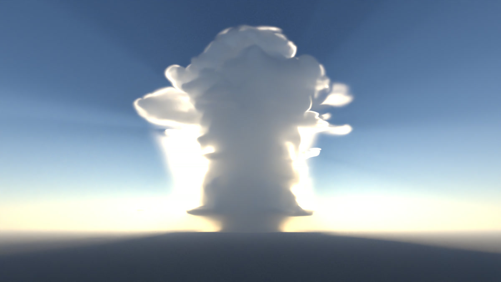
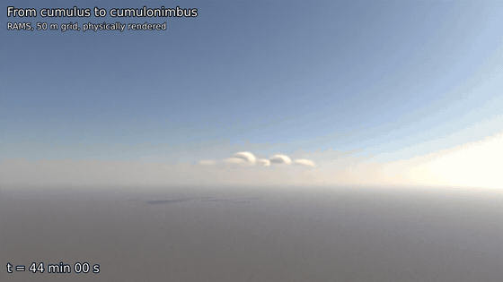
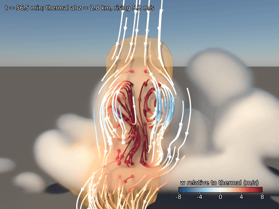

# skyvista

**3D visualization of gridded atmospheric data in Python**

<p align="center">
  
</p>

skyvista turns xarray datasets from atmospheric models (and other gridded data)
into 3D figures and animations. It has two rendering backends behind one
`Scene` API:

- **PyVista**, for fast, interactive exploration in Jupyter, an IDE, or a
  standalone HTML file.
- **Blender**, for publication-quality renders. Clouds are drawn from the
  model's hydrometeors with physically based optics, under a physical sky
  and sun.

<p align="center">
  
  
</p>

## Features

- **Gridded data**: isosurfaces, volumes, vector glyphs, streamlines, and
  planes such as cross-sections or the ground.
- **Physically based clouds** (Blender): extinction and scattering computed
  from mixing ratios and number concentrations, with presets for RAMS and CM1
  Morrison microphysics. Aerial perspective (haze), cutaways, and fading out
  neighbouring storms are built in.
- **Passive-tracer dye** (Blender): tracers drawn as a colored, semi-transparent
  dye, for example colored by the height the air started from.
- **Trajectories**: Lagrangian parcels as arrows, particles, or tapered trails
  that follow the parcels.
- **Animations**: over model time, or one time held still while arrows move
  along the streamlines. Blender animations render in parallel, resume after
  an interruption, and encode to video.
- **Camera paths**: keyframed cameras, or cameras that follow a storm track
  (for example from tobac).
- **Figure composition**: side-by-side panels with titles, timestamps,
  colorbars, and insets laid out by matplotlib.
- **Coordinate systems**: Cartesian, geographic (lat/lon), radar
  (range/azimuth/elevation), curvilinear, and unstructured grids, detected
  automatically.

## Installation

```bash
pip install skyvista
```

The Blender backend needs the `blender` extra. It installs Blender itself as
the `bpy` module, with Alembic and OpenVDB support and an ffmpeg for videos:

```bash
pip install "skyvista[blender]"
```

`bpy` has wheels only for Python 3.13, on Linux x86-64, Apple-silicon macOS
and Windows. Elsewhere, set `$SKYVISTA_BLENDER` to a standalone Blender 5.1+
program. To run the example notebooks, install the `notebooks` extra instead,
which adds JupyterLab and the model-output readers:

```bash
pip install "skyvista[notebooks]"
```

skyvista configures offscreen PyVista rendering on headless machines when it
is imported. To check your setup, run the built-in doctor, which renders a
test image and prints a fix for anything that fails:

```bash
python -m skyvista        # or:  import skyvista as sv; sv.doctor()
```

Interactive plots inside Jupyter can need extra setup for some frontends. See
[docs/pyvista_setup_tips.md](docs/pyvista_setup_tips.md).

## Quick start

An interactive PyVista scene:

```python
import skyvista as sv
import xarray as xr

storm_ds = xr.open_dataset("model_output.nc")

scene = sv.Scene()
scene.add_contour(storm_ds, "W", isosurfaces=[1, 3, 5, 10], cmap="Greens", opacity=0.8)
scene.add_contour(storm_ds, "RC", cmap="Blues", opacity=0.4)
scene.show()
```

A physically based cloud rendered with Blender, from RAMS hydrometeor fields:

```python
config = sv.BlenderExportConfig.for_clouds(quality="preview")
config.world.sun_elevation_deg = 30.0

sv.Scene().add_clouds(storm_ds, microphysics="rams").to_blender(
    "storm_render", config=config, render=True
)
```

`to_blender` writes a self-contained bundle: the meshes and volumes, a
`scene.json` manifest, the `.blend` file, and the rendered image.

## Documentation and examples

- [API guide](docs/API_guide.ipynb): the PyVista API, from convenience
  functions to the full specification classes.
- [Coordinate systems demo](examples/coordinate_systems_demo.ipynb):
  geographic, radar, and curvilinear grids.
- [Interactive HTML example](assets/example_interactive.html): a PyVista
  scene exported to HTML (download it and open it in a browser).
- [Blender example notebooks](examples/notebooks/README.md): storm portraits,
  winds and streamlines, tracer dye, animations that track a storm, and parcel
  trajectories, from RAMS and CM1 output.

## Data format

Gridded data are xarray `Dataset`s with `x`, `y`, and `z` coordinates (in
meters for the Blender backend), plus an optional `time` dimension for
animations. skyvista detects the coordinate system from coordinate names or
CF-convention attributes. Trajectory data have `trajectory_ix` and `time`
dimensions, with `x`, `y`, and `z` position variables.

## License

MIT License

## Citation

If you use skyvista in your research, please cite:

```bibtex
@software{skyvista,
  author = {Davis, Charles},
  title = {skyvista: 3D gridded atmospheric data visualization in Python},
  year = {2026},
  url = {https://github.com/cmdavis4/skyvista}
}
```
